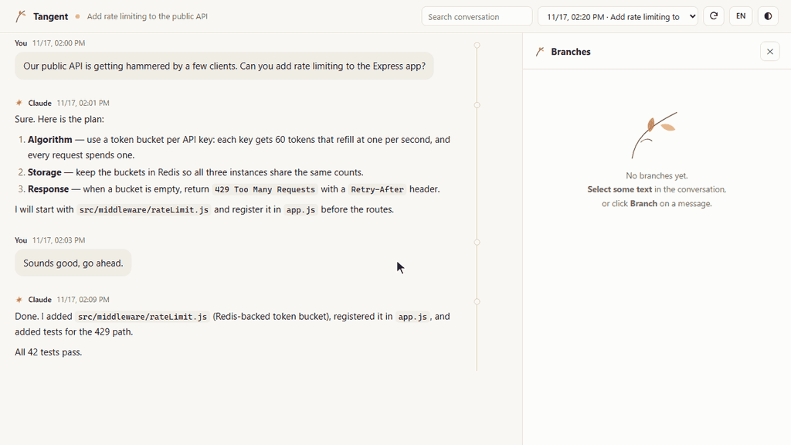

# Tangent

[English](README.md) | 한국어




Claude Code 대화를 브라우저에 띄워 두고, 문장을 골라 **가지 대화**를 치는 도구입니다.

Claude Code 대화는 한 줄로만 이어집니다. 중간에 "이 부분은 무슨 뜻이지?" 같은 곁가지 질문을 하면 본 흐름에 섞입니다. cq-web을 쓰면 원래 대화는 그대로 두고, 고른 문장만 맥락으로 가진 가지 대화를 옆 패널에서 이어 갈 수 있습니다.

## 기능

- **문장으로 가지 치기:** 대화에서 문장을 드래그하면 **가지 치기** 버튼이 뜹니다. 메시지 전체로 가지를 치려면 **가지** 버튼을 누릅니다.
- **가지 대화:** 고른 문장과 그 메시지의 질문·답변만 맥락으로 들어갑니다. 답이 실시간으로 나오고, 이어서 물어도 앞 대화를 기억합니다.
- **가지 표시:** 대화 옆 줄기에서 가지가 뻗어 나가고, 가지를 친 문장에는 하이라이트가 남습니다. 가지 목록은 저장되어 다음에 열어도 남아 있습니다.
- **파일 읽기(선택):** **파일 읽기** 스위치를 켜면 가지가 `Read`, `Grep`, `Glob`으로 프로젝트 파일을 보고 실제 코드를 근거로 답합니다. 수정이나 명령 실행은 여전히 못 하고, 프로젝트 폴더 밖 파일은 거부됩니다. 읽은 파일은 답변 위에 표시됩니다.
- **본 대화로 가져가기:** 가지에서 결론이 나면 **본 대화로** 버튼이 짧은 메모(주제 + 요점)를 만들어 줍니다. 고친 뒤 복사해서 원래 대화에 붙여 넣으면 됩니다. 요약은 가지의 복사본에서 돌기 때문에 가지 기록은 그대로입니다.
- **실시간 갱신:** 원래 대화에 새 메시지가 생기면 자동으로 붙습니다. 스크롤 위치와 선택한 문장은 유지됩니다.
- **가지의 가지:** 가지 대화 안에서 문장을 골라 다시 가지를 칠 수 있습니다. 가지 목록이 트리로 보이고, 가지가 뻗어 나온 문장에는 하이라이트가 남습니다.
- **가지별 모델 선택:** 기본 모델, Haiku(빠르고 저렴해서 가벼운 질문에 좋음), Sonnet, Opus 중에서 고릅니다.
- **가지 이름 붙이기:** 가지 제목을 누르면 이름을 바꿀 수 있습니다. 비우면 첫 질문으로 돌아갑니다. 이름은 목록에 보이고 검색도 됩니다.
- **내보내기:** 가지 대화를 마크다운 파일로 저장합니다.
- **가지 검색:** 검색창이 본 대화를 거르고, 내용이 맞는 가지도 목록에 보여 줍니다.
- **단축키:** `B` 선택한 문장으로 가지 치기, `/` 검색, `Esc` 뒤로.
- **터미널에서 이어가기:** 수정이나 명령 실행이 필요하면 이 버튼으로 같은 가지를 일반 Claude Code 터미널에서 이어 갑니다(`claude -r <가지 세션>`). 가능하면 `/tg`를 실행한 터미널에서 엽니다. **herdr**는 새 pane, **tmux**는 새 창, **WezTerm**·**Windows Terminal**은 새 탭, **Ghostty**·**iTerm2**는 새 창으로 열고, 그 밖에는 기본 터미널을 씁니다. 원하는 명령을 쓰려면 환경변수 `TANGENT_TERMINAL`을 지정합니다(예: `TANGENT_TERMINAL='open -na Ghostty.app --args --working-directory={cwd} -e {cmd}'`).
- **기타:** 대화 검색, 세션 바꾸기, 밝은/어두운 테마, 영어/한국어 화면(브라우저 언어를 따름)을 지원합니다.

## 요구 사항

- Node.js 18 이상
- 로그인된 Claude Code CLI(`claude` 명령)
- Windows 또는 macOS. Linux는 브라우저 열기는 되지만, 터미널 열기가 안 되면 명령을 복사해 줍니다.

## 설치

### Claude Code 플러그인으로 (추천)

Claude Code 입력창에서 다음을 실행합니다.

```
/plugin install tangent --marketplace closeup1202/tangent
```

마켓플레이스를 추가할지 물으면 `y`를 누르고, 설치 범위를 고릅니다. user 범위를 고르면 모든 프로젝트에서 `/tg`를 쓸 수 있습니다. 셸에서는 `claude plugin install tangent --marketplace closeup1202/tangent`로 같은 설치를 할 수 있습니다.

명령은 `/tg`입니다. 같은 이름의 명령이 이미 있으면 `/tangent:tg`가 됩니다.

### 직접 설치

```bash
git clone https://github.com/closeup1202/tangent.git
cd tangent
node install.mjs
```

설치가 끝나면 Claude Code를 다시 시작합니다.

설치 스크립트가 하는 일은 두 가지입니다.

- `~/.claude/commands/tg.md`에 `/tg` 명령을 만듭니다. 이 실행 하나만 승인 없이 돌도록 허용합니다.
- `~/.claude/tangent/launch.mjs`에 실행 진입점을 만듭니다. 이 파일이 레포의 `server.mjs`를 부릅니다.

레포를 다른 곳으로 옮겼다면 `node install.mjs`를 다시 실행하세요.

## 사용

Claude Code 대화창에서 다음을 입력합니다.

```
/tg
```

브라우저에 지금 대화가 뜹니다. 원래 대화에 새 메시지가 생기면 자동으로 화면에 붙습니다.

## 구조

| 파일 | 역할 |
|---|---|
| `server.mjs` | 로컬 서버. 세션 기록을 읽고, `claude -p`로 가지 대화를 실행합니다. 외부 패키지를 쓰지 않습니다. |
| `page.html` | 브라우저 화면(마크다운 렌더러 포함, 외부 CDN 없음) |
| `install.mjs` | 직접 설치할 때 `/tg` 명령 설치·제거 |
| `commands/tg.md`, `.claude-plugin/` | 플러그인 포장: `/tg` 명령, 매니페스트, 마켓플레이스 파일 |

- **원래 대화:** `~/.claude/projects/<작업 폴더>/<세션>.jsonl`을 읽기만 하고 고치지 않습니다.
- **가지 대화:** `claude -p --tools "" --strict-mcp-config`로 실행합니다(**파일 읽기**를 켜면 `--tools Read,Grep,Glob`). 첫 질문에는 `--append-system-prompt-file`로 맥락을 넣고, 이어지는 질문은 `--resume`으로 보냅니다. 가지 대화도 Claude Code 세션으로 저장되므로 구독 사용량을 씁니다.
- **가지 기록:** `~/.claude/tangent/data/`에 저장합니다. 대화 내용이 들어 있으니 레포에 넣지 않습니다. 저장 위치는 환경변수 `TANGENT_DATA`로 바꿀 수 있습니다.

## 보안

- 서버는 `127.0.0.1`에만 열리고, 실행할 때마다 임의 토큰을 씁니다. Host와 Origin 헤더도 검사합니다.
- 10분 동안 요청이 없으면 서버가 스스로 꺼집니다.
- 가지 대화에서는 파일 수정이나 명령 실행을 할 수 없습니다. 승인 창을 띄울 곳이 없기 때문입니다. **파일 읽기**를 켜면 읽기 도구만 쓰고, 승인이 필요한 동작(프로젝트 밖 파일 읽기 등)은 거부됩니다.

## 한계

- **Claude Code 내부 세션 파일 형식에 기댑니다.** 형식이 바뀌면 메시지를 못 읽을 수 있습니다. 형식을 읽는 코드는 `server.mjs`의 "session reading" 부분에 모아 두었습니다.
- **macOS는 아직 실제로 돌려 보지 않았습니다.** 코드상으로는 지원하지만 확인이 필요합니다. 브라우저는 `open`으로 열고, 터미널은 Terminal.app을 `osascript`로 엽니다.
- Windows에서 `claude`가 npm으로 설치돼 있으면(`claude.cmd`) 셸을 거쳐 실행합니다. 경로가 특이하면 환경변수 `TANGENT_CLAUDE_BIN`에 실행 파일 경로를 지정하세요.

## 제거

플러그인으로 설치했다면 `/plugin uninstall tangent`(또는 `claude plugin uninstall tangent`)를 실행합니다.

직접 설치했다면 다음을 실행합니다.

```bash
node install.mjs --uninstall          # /tg 명령과 진입점 제거 (가지 기록은 남김)
node install.mjs --uninstall --purge  # 가지 기록까지 제거
```

## 라이선스

MIT

---

Tangent는 개인 프로젝트이며 Anthropic과 관계가 없고, Anthropic이 보증하지 않습니다.
