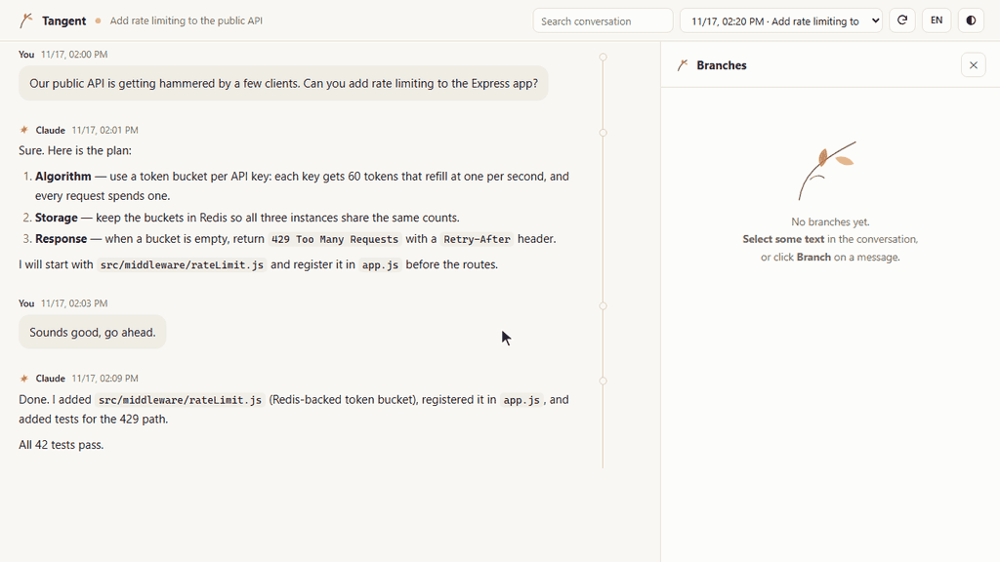

# Tangent

**Go off on a tangent without derailing your Claude Code session.**

English | [한국어](README.ko.md)



A Claude Code conversation is a single line. When you want to ask *"wait, what does this part mean?"* halfway through a task, you have two options: ask it in the main thread and clutter the context, or don't ask at all.

Tangent opens your current session in the browser. Highlight any sentence, click **Branch**, and ask your side question in a panel next to it. The branch only knows the part you picked. Your main session stays untouched.

## Features

- **Branch from a sentence.** Select text in any message and click **Branch**, or branch from a whole message.
- **Focused context.** A branch sees only the selected text and the question/answer pair it came from, not your whole session.
- **Streaming answers.** Follow-up questions in a branch remember the earlier ones.
- **Branches are visible.** Branches grow as twigs off the conversation's trunk, and the sentences you branched from stay highlighted. Branches are saved, so they are still there next time.
- **Read files (optional).** Flip the **Read files** switch and the branch can look at your project with `Read`, `Grep` and `Glob`, so it answers from the actual code. It still cannot edit anything or run commands, and files outside the project folder are refused. Each file it reads shows up as a chip above the answer.
- **Bring it back.** When a branch reaches a conclusion, **Bring back** writes a short note (topic + bullet points) that you can edit, copy and paste into the main session. The summary runs on a throwaway copy, so the branch history stays clean.
- **Live.** New messages in the main session appear automatically. No reload needed, and your scroll position and text selection are kept.
- **Branches of branches.** Select text inside a branch to branch again. Branches form a tree in the list, and the text a nested branch grew from stays highlighted.
- **Pick a model per branch.** Default, Haiku (fast and cheap for quick questions), Sonnet or Opus.
- **Name your branches.** Click a branch title to rename it (empty goes back to the first question). Names show in the list and are searchable.
- **Export.** Save any branch as a Markdown file.
- **Search branches too.** The search box filters the main thread and lists the branches whose content matches.
- **Keyboard.** `B` branches from the current selection, `/` focuses search, `Esc` goes back.
- **Continue in the terminal.** When you need edits or shell commands, one click reopens the same branch as a regular Claude Code session (`claude -r <branch>`), in the terminal you ran `/tg` from where possible: a new pane in **herdr**, a new window in **tmux**, a new tab in **WezTerm** or **Windows Terminal**, a new **Ghostty** or **iTerm2** window; otherwise the default terminal. Set `TANGENT_TERMINAL` to use your own command, e.g. `TANGENT_TERMINAL='open -na Ghostty.app --args --working-directory={cwd} -e {cmd}'`.
- **Also included:** search, a session switcher, light and dark themes, and an English/Korean UI (follows your browser language).

## How it differs from built-in commands

| | `/btw` | `/branch` | Tangent |
|---|---|---|---|
| Anchored to a specific sentence | – | – | ✓ |
| Answer is kept | – | ✓ | ✓ |
| Context | whole session | whole session (copied) | selected part only |
| Several side threads, visible at a glance | – | – | ✓ |
| Branch again from inside a branch | – | – | ✓ |
| Tools | none | full | optional read-only (one click to a full terminal session) |
| Bring the result back to the main thread | – | manual | ✓ (summary to paste) |

## Requirements

- Node.js 18 or later
- The [Claude Code](https://code.claude.com/docs) CLI, logged in (`claude` on your `PATH`)
- Windows or macOS. Linux works for the browser part; if no terminal can be opened, the command is copied for you.

## Install

### As a Claude Code plugin (recommended)

At the Claude Code prompt:

```
/plugin install tangent --marketplace closeup1202/tangent
```

Answer `y` to add the marketplace, then pick a scope (user scope makes `/tg` available in every project). From a shell, the same is `claude plugin install tangent --marketplace closeup1202/tangent`.

The command is `/tg`. If another plugin or command already uses that name, it is `/tangent:tg`.

### Manually

```bash
git clone https://github.com/closeup1202/tangent.git
cd tangent
node install.mjs
```

The installer:

- writes the `/tg` slash command to `~/.claude/commands/tg.md`, pre-allowed so it runs without a permission prompt;
- writes a small launcher to `~/.claude/tangent/launch.mjs` that points to this repo.

Restart Claude Code after installing. If you move the repo, run `node install.mjs` again.

## Usage

In any Claude Code session, type:

```
/tg
```

Your conversation opens in the browser. Highlight text, click **Branch**, and ask. New messages in the main session show up automatically.

## How it works

| File | Role |
|---|---|
| `server.mjs` | Local server. Reads the session log and runs branch chats through `claude -p`. No dependencies. |
| `page.html` | The UI. Includes a small built-in Markdown renderer; no CDN. |
| `install.mjs` | Manual install and uninstall of the slash command. |
| `commands/tg.md`, `.claude-plugin/` | Plugin packaging: the `/tg` command, manifest and marketplace file. |

- **Your session is read-only.** Tangent reads `~/.claude/projects/<project>/<session>.jsonl` and never writes to it.
- **Branches are ordinary Claude Code sessions.** They run with `claude -p --tools "" --strict-mcp-config` (or `--tools Read,Grep,Glob` when **Read files** is on). The first message gets the picked context through `--append-system-prompt-file`, and follow-ups use `--resume`. Branches count toward your normal Claude usage.
- **Branch data lives outside the repo,** in `~/.claude/tangent/data/`. It contains conversation text. Override the location with `TANGENT_DATA`.

## Security

- The server listens only on `127.0.0.1`. It uses a random token per launch and checks the `Host` and `Origin` headers.
- It shuts itself down after 10 minutes without requests.
- Branch chats can never edit files or run commands, because there is nowhere to show a permission prompt. With **Read files** on they get read-only tools; anything that would need a permission prompt (such as reading outside the project) is denied.

## Limitations

- **Tangent depends on Claude Code's internal session format.** A Claude Code update could break parsing. All format-specific code is in the "session reading" section of `server.mjs`.
- **macOS support is new.** The browser opens with `open`, and the terminal is Terminal.app through `osascript`. Please open an issue if something misbehaves.
- **If `claude` was installed through npm on Windows** (`claude.cmd`), it runs through the shell. Set `TANGENT_CLAUDE_BIN` if your binary is somewhere unusual.

## Uninstall

Plugin: `/plugin uninstall tangent` (or `claude plugin uninstall tangent`).

Manual install:

```bash
node install.mjs --uninstall          # remove the command and launcher, keep branch data
node install.mjs --uninstall --purge  # also delete branch data
```

## License

MIT

---

Tangent is an independent project and is not affiliated with or endorsed by Anthropic.
